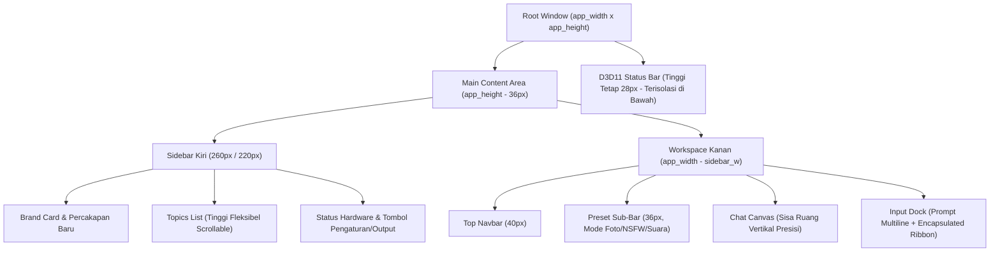

# 🎨 AI Studio Native — Sistem Desain UI/UX All-New (Direct3D 11 & ImGui)

Dokumentasi resmi arsitektur antarmuka pengguna (*User Interface*) dan pengalaman pengguna (*User Experience*) untuk **AI Studio Native (Windows x64 C++ & Mobile WebView)**.

---

## 🏛️ 1. Filosofi Desain: Zero-Collision & High-Aesthetic Utility

> [!IMPORTANT]
> **Prinsip Utama Tata Letak (Anti-Tabrak & Anti-Terpotong):**
> 1. **Pemisahan Ruang Secara Matematika Murni**: Setiap zona layar (Header, Sidebar, Workspace, Ribbon Opsi, Status Bar) memiliki kuota tinggi dan lebar yang terisolasi secara hierarkis. Tidak ada elemen yang boleh mengandalkan asumsi koordinat kursor sembarangan.
> 2. **Adaptive 2-Tier Control Ribbon**: Pada ukuran jendela sedang (<720px), kontrol studio foto otomatis beralih menjadi 2 baris rapi berkartu tanpa pernah meluap (*overflow*) atau menimpa status bar.
> 3. **Penyelarasan Sentuh & Mouse Presisi 0-Padding**: Menghilangkan padding sentuh liar (`TouchExtraPadding = 0`) sehingga geometri komputasi Dear ImGui 100% konsisten dengan render GPU Direct3D 11.

---

## 📐 2. Diagram Geometri Grid Layar

---

## 🎨 3. Palet Warna & Token Visual (Obsidian Studio Palette)

Antarmuka dibangun dengan palet warna bernuansa **Cyber Studio Dark Glass**:

| Token Desain | Nilai Hex | ImVec4 (RGBA) | Fungsi Penggunaan |
| :--- | :--- | :--- | :--- |
| **`Bg-Root`** | `#090D14` | `(0.035, 0.050, 0.080, 1.0)` | Latar belakang dasar jendela Direct3D 11 |
| **`Bg-Card`** | `#0E1421` | `(0.055, 0.080, 0.130, 0.95)` | Panel kartu, bubble pesan, dan child window |
| **`Bg-Input`** | `#141F30` | `(0.080, 0.120, 0.190, 1.0)` | Kotak teks multiline, combo box, dan slider |
| **`Border-Muted`** | `#243047` | `(0.140, 0.190, 0.280, 0.70)` | Garis batas pemisah halus antar komponen |
| **`Accent-Blue`** | `#3182CE` | `(0.130, 0.350, 0.750, 0.90)` | Tombol aksi utama, tab chat aktif, tombol Kirim |
| **`Accent-Purple`**| `#8B5CF6` | `(0.450, 0.180, 0.720, 1.0)` | Tombol ✨ Prompt Pintar (AI Brain Expansion) |
| **`Accent-Rose`**  | `#F43F5E` | `(0.880, 0.140, 0.380, 1.0)` | Tab Mode Dewasa (NSFW) & highlight sensual |
| **`Accent-Mint`**  | `#10B981` | `(0.080, 0.650, 0.520, 1.0)` | Tab Suara AI, Audio Speech synthesis & status RAM OK |
| **`Text-Primary`** | `#F1F5F9` | `(0.940, 0.960, 0.980, 1.0)` | Teks tajam dengan font Segoe UI Windows |
| **`Text-Muted`**   | `#8899AC` | `(0.500, 0.580, 0.680, 1.0)` | Teks sekunder, timestamp, dan pintasan keyboard |

---

## 🧩 4. Spesifikasi Komponen Utama

### A. Sidebar Kiri (Navigasi Sesi & Status Mesin)
- **Brand Header Card**: Kartu berbingkai elegan dengan teks `⚡ AI STUDIO NATIVE` dan indikator hijau `🟢 100% C++ Direct3D 11`.
- **Tombol Percakapan Baru**: Berada tepat di bawah logo, memudahkan pengguna membuat sesi bersih sekali klik.
- **Topics List**: Menggunakan perhitungan dinamis:
  $$\text{topics\_h} = \text{main\_content\_h} - \text{header\_h} - \text{footer\_h}$$
  Menjamin daftar obrolan dapat di-scroll vertikal dan **tidak akan pernah** mendorong tombol Pengaturan/Output ke luar layar.
- **Hardware Telemetry Card & Footer**: Kartu real-time penggunaan RAM dengan micro-progress bar, status thread CPU AVX2, kartu grafis GPU, serta tombol `[⚙️ Pengaturan]` dan `[📁 Output]`.

### B. Workspace Kanan (Studio Kreatif)
- **Top Navbar**: 6 tab mode utama (`Home`, `Chat AI`, `Studio Foto`, `Dewasa 18+`, `Video AI`, `Suara AI`), dropdown model aktif yang otomatis menyesuaikan lebar, tombol `[+ Model]` untuk impor berkas model lokal, dan tombol `[⛶ Layar Penuh]`.
- **Sub-Navbar Preset**: Menampilkan preset fotografi instan (`Sensual Bedroom`, `Pantai Glamour`, `Fine Art Nude`, `Fitness Model`, `Full Body`), serta saklar fitur tanpa tombol tanda tanya yang berdesakan.
- **Chat Canvas**: Menampilkan balon percakapan Direct3D 11. Balon respons AI otomatis menyaring tag berpikir reasoning (`💭 [Pemikiran Logika DeepSeek]`) dan menampilkan teks bersih.
- **Bottom Input Dock & Options Ribbon**:
  - **Kotak Input Multiline**: Input prompt luas dengan dukungan tombol cepat `Shift+Enter` (baris baru) dan `Enter` (generate).
  - **Tombol Aksi Cepat**: `[✨ Prompt Pintar]` untuk mengembangkan ide singkat secara otomatis menjadi prompt 8K fotorealistis, dan `[Kirim]`.
  - **Encapsulated Options Ribbon**: Ruang kendali berbingkai khusus (`PhotoOptionsRibbon` / `TextOptionsRibbon`) yang memisahkan dropdown parameter (`Prompt Asli/Auto`, `Sudut Kamera`, `Rasio Aspek`, `Steps`, `HD Wajah`, `Foto Acuan`).

### C. Penampil Gambar Layar Penuh Sinematik (DirectX 11 Modal)
- Gambar di dalam bubble obrolan dapat langsung diklik atau dengan menekan tombol `[🔍 Layar Penuh]`.
- Menampilkan gambar di tengah layar dengan latar belakang gelap elegan (transparansi 96%), menjaga rasio aspek asli, serta menampilkan ukuran resolusi (contoh: `512 x 768 px`).
- Tombol aksi terintegrasi: `[📁 Buka di File Explorer]`, `[🖼️ Buka di Aplikasi Windows]`, dan `[📋 Salin Path Gambar]`.
- Dapat ditutup seketika dengan tombol keyboard `ESC` atau tombol merah `❌ Tutup (ESC)`.

### D. Status Bar Telemetri Hardware (Zona Mandiri Paling Bawah)
- Menempati porsi tinggi 28px di bagian terbawah jendela aplikasi.
- Garis pemisah atas 1px warna navy kontras.
- Memantau RAM, beban CPU & thread aktif, kapabilitas SIMD AVX2+FMA, akselerasi TAESD Fast VAE, dan real-time FPS Direct3D 11.

---

## ⌨️ 5. Pintasan Keyboard Global

| Shortcut | Aksi |
| :--- | :--- |
| **`F11`** | Beralih antara Layar Penuh (*Borderless Fullscreen*) dan mode jendela biasa |
| **`ESC`** | Menutup modal penampil foto layar penuh atau jendela dialog |
| **`Enter`** | Mengirim pesan atau memulai proses generate gambar |
| **`Shift + Enter`** | Membuat baris teks baru di dalam kotak input prompt |
| **`Ctrl + Enter`** | Alternatif baris baru di dalam mode multiline |

---

*Dokumen ini merupakan bagian dari standar arsitektur resmi AI Studio Native v1.5.0.*
