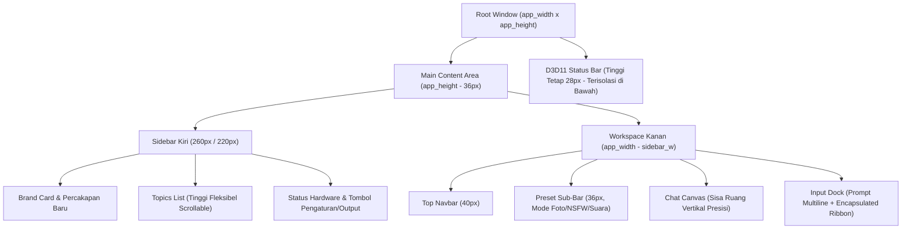

# 🎨 AI Studio Native — Sistem Desain UI/UX All-New (Direct3D 11 & ImGui)

Dokumentasi resmi arsitektur antarmuka pengguna (*User Interface*) dan pengalaman pengguna (*User Experience*) untuk **AI Studio Native (Windows x64 C++ & Mobile WebView)**.

---

## 🏛️ 1. Filosofi Desain: Zero-Collision & High-Aesthetic Utility

> [!IMPORTANT]
> **Prinsip Utama Tata Letak (Anti-Tabrak, Anti-Terpotong & Bebas Scroll Liar):**
> 1. **Pemisahan Ruang Secara Matematika Murni**: Jendela utama (`RootWindow`) memiliki kuota ukuran presisi 1:1 terhadap client window (`WindowPadding = (0, 0)`, `WindowBorderSize = 0`). Seluruh ruang partisi (Header, Sidebar, Workspace, Ribbon Opsi, Status Bar) dihitung tepat hingga piksel terakhir tanpa kelebihan ruang yang memicu scrollbar window.
> 2. **Peniadaan Scrollbar Liar & Global Shift**: Flag `ImGuiWindowFlags_NoScrollbar | ImGuiWindowFlags_NoScrollWithMouse` dipasang pada root window dan sidebar, sehingga scrolling mouse tidak akan pernah menggeser layout aplikasi atau membuat status bar melompat.
> 3. **Auto-Scrollbar Cerdas**: Container konten seperti `ChatCanvas`, `TopicsList`, dan `DashboardHub` menggunakan auto-scrollbar (hanya memunculkan batang scrollbar vertikal saat jumlah item meluap dari batas tinggi). Jika isi masih muat, area tampil bersih 100% tanpa garis scroll abu-abu.
> 4. **Adaptive 2-Tier Control Ribbon & Uniform Input Height**: Pada ukuran jendela sedang (<720px), kontrol studio foto otomatis beralih menjadi 2 baris rapi berkartu. Kotak input multiline, tombol Prompt Pintar, dan tombol Kirim diselaraskan pada tinggi seragam (46px).

---

## 📐 2. Diagram Geometri Grid Layar

---

## 🎨 3. Palet Warna & Token Visual (Obsidian Studio Palette)

Antarmuka dibangun dengan palet warna bernuansa **Cyber Studio Dark Glass**:

| Token Desain | Nilai Hex | ImVec4 (RGBA) | Fungsi Penggunaan |
| :--- | :--- | :--- | :--- |
| **`Bg-Root`** | `#090D14` | `(0.035, 0.050, 0.080, 1.0)` | Latar belakang dasar jendela Direct3D 11 |
| **`Bg-Card`** | `#0E1421` | `(0.055, 0.080, 0.130, 0.95)` | Panel kartu, bubble pesan, dan child window |
| **`Bg-Input`** | `#141F30` | `(0.080, 0.120, 0.190, 1.0)` | Kotak teks multiline, combo box, dan slider |
| **`Border-Muted`** | `#243047` | `(0.140, 0.190, 0.280, 0.70)` | Garis batas pemisah halus antar komponen |
| **`Accent-Blue`** | `#3182CE` | `(0.130, 0.350, 0.750, 0.90)` | Tombol aksi utama, tab chat aktif, tombol Kirim |
| **`Accent-Purple`**| `#8B5CF6` | `(0.450, 0.180, 0.720, 1.0)` | Tombol ✨ Prompt Pintar (AI Brain Expansion) |
| **`Accent-Rose`**  | `#F43F5E` | `(0.880, 0.140, 0.380, 1.0)` | Tab Mode Dewasa (NSFW) & highlight sensual |
| **`Accent-Mint`**  | `#10B981` | `(0.080, 0.650, 0.520, 1.0)` | Tab Suara AI, Audio Speech synthesis & status RAM OK |
| **`Text-Primary`** | `#F1F5F9` | `(0.940, 0.960, 0.980, 1.0)` | Teks tajam dengan font Segoe UI Windows |
| **`Text-Muted`**   | `#8899AC` | `(0.500, 0.580, 0.680, 1.0)` | Teks sekunder, timestamp, dan pintasan keyboard |

---

## 🧩 4. Spesifikasi Komponen Utama

### A. Sidebar Kiri (Navigasi Sesi & Status Mesin - Fixed 100% Unscrollable)
- **Brand Header Card**: Kartu berbingkai liquid glass elegan dengan teks `⚡ AI STUDIO NATIVE` dan indikator hijau `🟢 100% C++ Direct3D 11`. Memiliki flag `ImGuiWindowFlags_NoScrollWithMouse` untuk mengunci posisi mutlak.
- **Top Quick Actions (+ Percakapan & ⚙️ Pengaturan)**: Tombol `[+ Percakapan]` berdampingan dengan tombol cepat gear `[⚙️]` di bagian paling atas sidebar, memungkinkan pengguna membuka pengaturan instan tanpa perlu melakukan scroll ke bawah sama sekali.
- **Topics List**: Menggunakan perhitungan dinamis berbasis sisa ruang yang tersedia:
  $$\text{topics\_h} = \text{avail\_h} - \text{sidebar\_footer\_h (168px)}$$
  Container induk `SidebarPanel` dikunci mati dengan `ImGuiWindowFlags_NoScrollbar | ImGuiWindowFlags_NoScrollWithMouse`, menjamin sidebar tidak pernah bisa digulung roda mouse ke atas/bawah. Hanya daftar percakapan di bagian tengah (`TopicsList`) yang menggulung secara mandiri saat sesi bertambah banyak.
- **Hardware Telemetry Card & Footer**: Kartu real-time penggunaan RAM dengan micro-progress bar, status thread CPU AVX2, kartu grafis GPU, serta tombol `[⚙️ Pengaturan]` dan `[📁 Output]` yang selalu terpancang kokoh 100% di bawah tanpa pernah tergeser atau terpotong.

### B. Workspace Kanan (Studio Kreatif)
- **Top Navbar**: 6 tab mode utama (`Home`, `Chat AI`, `Studio Foto`, `Dewasa 18+`, `Video AI`, `Suara AI`), dropdown model aktif yang otomatis menyesuaikan lebar, tombol `[+ Model]` untuk impor berkas model lokal, tombol `[⛶ Layar Penuh]`, serta tombol `[⚙️ Pengaturan]` yang selalu terpampang jelas di pojok kanan atas layar dengan akses 1-klik tanpa scroll.
- **Sub-Navbar Preset**: Menampilkan preset fotografi instan (`Sensual Bedroom`, `Pantai Glamour`, `Fine Art Nude`, `Fitness Model`, `Full Body`), serta saklar fitur tanpa tombol tanda tanya yang berdesakan.
- **Chat Canvas**: Menampilkan balon percakapan Direct3D 11. Balon respons AI otomatis menyaring tag berpikir reasoning (`💭 [Pemikiran Logika DeepSeek]`) dan menampilkan teks bersih.
- **Bottom Input Dock & Options Ribbon**:
  - **Kotak Input Multiline**: Input prompt luas dengan dukungan tombol cepat `Shift+Enter` (baris baru) dan `Enter` (generate).
  - **Tombol Aksi Cepat**: `[✨ Prompt Pintar]` untuk mengembangkan ide singkat secara otomatis menjadi prompt 8K fotorealistis, dan `[Kirim]`.
  - **Encapsulated Options Ribbon**: Ruang kendali berbingkai khusus (`PhotoOptionsRibbon` / `TextOptionsRibbon`) yang memisahkan dropdown parameter (`Prompt Asli/Auto`, `Sudut Kamera`, `Rasio Aspek`, `Steps`, `HD Wajah`, `Foto Acuan`).

### C. Penampil Gambar Layar Penuh Sinematik (DirectX 11 Modal)
- Gambar di dalam bubble obrolan dapat langsung diklik atau dengan menekan tombol `[🔍 Layar Penuh]`.
- Menampilkan gambar di tengah layar dengan latar belakang gelap elegan (transparansi 96%), menjaga rasio aspek asli, serta menampilkan ukuran resolusi (contoh: `512 x 768 px`).
- Tombol aksi terintegrasi: `[📁 Buka di File Explorer]`, `[🖼️ Buka di Aplikasi Windows]`, dan `[📋 Salin Path Gambar]`.
- Dapat ditutup seketika dengan tombol keyboard `ESC` atau tombol merah `❌ Tutup (ESC)`.

### D. Status Bar Telemetri Hardware (Zona Mandiri Paling Bawah)
- Menempati porsi tinggi 28px di bagian terbawah jendela aplikasi.
- Garis pemisah atas 1px warna navy kontras.
- Memantau RAM, beban CPU & thread aktif, kapabilitas SIMD AVX2+FMA, akselerasi TAESD Fast VAE, dan real-time FPS Direct3D 11.

---

## ⌨️ 5. Pintasan Keyboard Global

| Shortcut | Aksi |
| :--- | :--- |
| **`F11`** | Beralih antara Layar Penuh (*Borderless Fullscreen*) dan mode jendela biasa |
| **`ESC`** | Menutup modal penampil foto layar penuh atau jendela dialog |
| **`Enter`** | Mengirim pesan atau memulai proses generate gambar |
| **`Shift + Enter`** | Membuat baris teks baru di dalam kotak input prompt |
| **`Ctrl + Enter`** | Alternatif baris baru di dalam mode multiline |

---

## ⚡ 6. Arsitektur Manajemen Memori: Menu Batas RAM & Mode Los RAM

Sistem manajemen memori AI Studio Native dirancang untuk memberikan fleksibilitas total antara efisiensi laptop hemat daya dan performa ekstrem tanpa batas:

### A. Pilihan Profil Alokasi RAM (Working Set Clamping)
Tersedia melalui dropdown di Modal Pengaturan (`[⚙️ Pengaturan]` -> `Pengelolaan & Optimasi Memori`) dan ditampilkan status lencananya di Sidebar:

1. **🚀 Mode Los RAM (Unlimited / Bebas)**:
   - Menghapus semua batasan alokasi (`SetProcessWorkingSetSize((SIZE_T)-1, (SIZE_T)-1)`).
   - Seluruh core CPU dan thread engine berjalan pada kecepatan komputasi maksimal dengan konteks LLM penuh (4096 tokens).
2. **🛡️ Batas 4 GB (Hemat - Laptop 8 GB)**:
   - Mengunci kuota memori fisik proses maksimal 4 GB (`max_ws = 4 GB`).
   - Sangat ideal untuk laptop dengan RAM 8 GB agar Windows dan aplikasi lain (browser, dokumen) tidak mengalami lag atau swapping ke disk. Konteks LLM disesuaikan ke 2048 tokens.
3. **⚖️ Batas 6 GB (Seimbang - Standar)**:
   - Mengunci kuota memori fisik maksimal 6 GB.
   - Pilihan ideal untuk laptop 8 GB - 12 GB RAM dengan konteks LLM 3072 tokens.
4. **⚡ Batas 8 GB (Maksimal Multitasking)**:
   - Memberikan kelonggaran hingga 8 GB untuk laptop/PC dengan RAM 16 GB ke atas.

### B. Tombol Aksi Cepat "🧹 Los RAM Sekarang" (Instant Purge)
- Diletakkan di **Sidebar Kiri** (tepat di bawah micro-progress bar RAM) dan di **Modal Pengaturan**.
- Menjalankan `MemoryManager::Get().PurgeAllAsync()` di background thread secara non-blocking:
  - Mengosongkan cache tekstur GPU Direct3D 11 (`m_pd3dDeviceContext->Flush()`).
  - Melepaskan memori halaman tak terpakai ke OS via Windows API `EmptyWorkingSet(GetCurrentProcess())`.
  - Seketika mereklamasi ratusan megabyte hingga gigabyte RAM yang membengkak.

### C. Auto-Los RAM Pasca-Render
- Opsi checkbox `"Auto-Los RAM setelah selesai render"` di Pengaturan.
- Ketika aktif (default: ON), worker thread secara otomatis memicu pembersihan memori seketika setelah AI selesai menghasilkan foto atau teks balasan, memastikan aplikasi kembali ke kondisi *lean & light*.

---

*Dokumen ini merupakan bagian dari standar arsitektur resmi AI Studio Native v1.5.3.*
