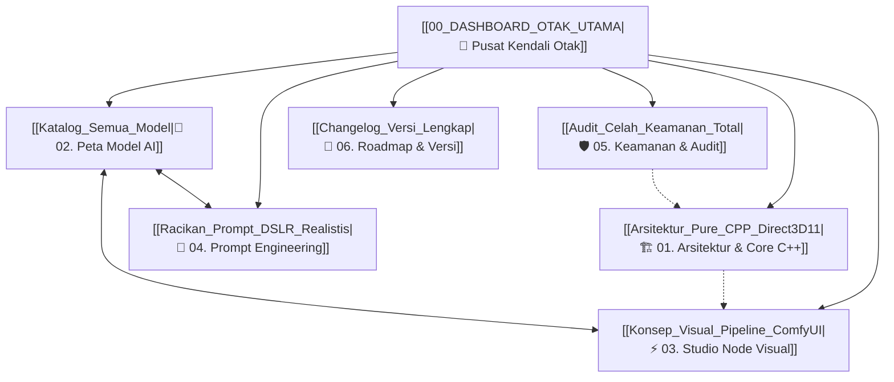

# 🧠 DASHBOARD OTAK UTAMA: AI STUDIO NATIVE

Selamat datang di **Second Brain & Knowledge Base** proyek **AI Studio Native** (100% Pure C++ Direct3D 11 Local AI Studio). Vault Obsidian ini berfungsi sebagai pusat dokumentasi arsitektur, racikan model, mitigasi keamanan, hingga panduan prompt visual.

---

## 🗺️ PETA KONTEN UTAMA (MAP OF CONTENT)

### 🏗️ [[Arsitektur_Pure_CPP_Direct3D11|1. Arsitektur & Core C++ Native]]
- [[Arsitektur_Pure_CPP_Direct3D11|Arsitektur Pure C++ & Direct3D 11 Pipeline]]
- [[SIMD_AVX2_Dan_Optimasi_Mesin|Vektorisasi SIMD AVX2 + FMA & Zero-Python]]
- [[Manajemen_Memori_RAM_Dan_VRAM|Manajemen RAM Laptop & Auto Purge VRAM]]
- [[Audio_Dan_Voice_SAPI_Piper|Sistem Suara Offline (Windows SAPI & Piper TTS)]]

### 🤖 [[Katalog_Semua_Model|2. Peta Model AI (Katalog & Karakter)]]
- [[Katalog_Semua_Model|Katalog Lengkap Semua Model Difusi & LLM]]
- [[ChilloutMix_Ni_Spesialis_Asia|ChilloutMix Ni - Spesialis Foto Wanita Asia & NSFW]]
- [[GhostMix_V2_Anime_Realism_NSFW|GhostMix V2.0 - 2.5D Anime Realism Uncensored (Baked VAE)]]
- [[CyberRealistic_V5_DSLR_Murni|CyberRealistic V5.0 - Foto DSLR Autentik & Tekstur Kulit]]
- [[DreamShaper8_LCM_Turbo|DreamShaper 8 LCM - Akselerasi Kilat 4-Step CPU]]
- [[Realistic_Vision_V51|Realistic Vision V5.1 - Pencahayaan Studio Portret]]
- [[Qwen_Dan_Sakura_LLM|Qwen 2.5 Coder & Sakura Iris 3B - Otak Percakapan C++]]

### ⚡ [[Konsep_Visual_Pipeline_ComfyUI|3. Studio Node Visual (Visual Graph Engine)]]
- [[Konsep_Visual_Pipeline_ComfyUI|Konsep Pipeline Visual Mirip ComfyUI Native]]
- [[Node_Model_Checkpoint_Loader|Node Model: Checkpoint Loader & Tombol Rekomendasi]]
- [[Node_Prompt_Dan_Saran_Interaktif|Node Prompt: Panel Rekomendasi Non-Destruktif]]
- [[Node_Sampler_Dan_Resolusi_250p|Node Sampler: Multi-Resolusi 250p/380p & K-Sampling]]
- [[Kabel_Bezier_Dan_Routing_Data|Matematika Kabel Bezier Kubik & Canvas Smooth Panning]]

### 🎨 [[Racikan_Prompt_DSLR_Realistis|4. Prompt Engineering & Panduan Preset]]
- [[Racikan_Prompt_DSLR_Realistis|Racikan Prompt DSLR & Kamera 85mm f/1.4]]
- [[Teknik_Multi_Person_2_Orang|Teknik Generasi 2 Orang / Couple Tanpa Wajah Menyatu]]
- [[Master_Anti_Plastic_Negative_Filter|Master Anti-Plastic Negative Filter (Cegah Muka Boneka)]]
- [[Panduan_Resolusi_Rendah_CPU|Panduan Generasi Cepat Resolusi Rendah di CPU]]

### 🛡️ [[Audit_Celah_Keamanan_Total|5. Keamanan, Eksploitasi & Audit Sistem]]
- [[Audit_Celah_Keamanan_Total|Laporan Audit Keamanan Total (5 Celah yang Ditambal)]]
- [[Analisis_Dampak_Dan_Eksploitasi|Analisis Dampak Teknis & Skenario Ancaman (Threat Modeling)]]
- [[Standar_Keamanan_Input_CLI|Standar Keamanan Input Argumen CLI & Escape Rule]]

### 🚀 [[Changelog_Versi_Lengkap|6. Changelog & Roadmap]]
- [[Changelog_Versi_Lengkap|Riwayat Pembaruan Versi (v1.0 -> v2.8)]]
- [[Roadmap_Pengembangan_Masa_Depan|Roadmap Fitur Masa Depan]]

---

> [!tip] Cara Membuka di Obsidian
> Buka aplikasi **Obsidian** -> Pilih **"Open folder as vault"** -> Pilih folder `otak_obsidian` di repositori ini. Seluruh tautan `[[Wikilinks]]` dan diagram Mermaid akan otomatis terhubung menjadi jaring-jaring pengetahuan graf visual!
