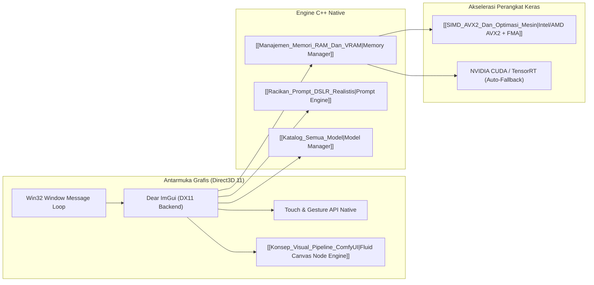

# 🏗️ Arsitektur Pure C++ & Direct3D 11

AI Studio Native dibangun dengan filosofi **0% Python Dependency pada GUI Runtime**. Seluruh siklus hidup aplikasi berjalan di atas pustaka native Windows C++ dengan Direct3D 11.

## 🔑 Fitur Utama Arsitektur:
1. **Direct3D 11 VSync 60 FPS**: Rendering antarmuka mulus dengan latensi input mendekati nol.
2. **Win32 Touch Gesture API**: Mendukung cubitan zoom (*pinch-to-zoom*) dan geseran multi-jari secara langsung dari layar sentuh laptop.
3. **Decoupled Worker Threads**: Proses generasi AI (SD & LLM) berjalan di thread terpisah (`std::thread`), sehingga UI tetap responsif 100% dan tidak pernah *Not Responding*.

Tautan Terkait:
- [[SIMD_AVX2_Dan_Optimasi_Mesin|Vektorisasi SIMD AVX2 & Optimasi]]
- [[Konsep_Visual_Pipeline_ComfyUI|Studio Node Visual Engine]]
- [[00_DASHBOARD_OTAK_UTAMA|Kembali ke Dashboard Otak]]
