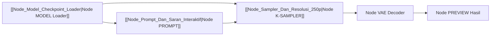

# ⚡ Konsep Pipeline Visual Mirip ComfyUI Native

Studio Node di AI Studio Native dirancang untuk memberikan fleksibilitas penuh perakitan alur pipa difusi secara visual tanpa membutuhkan Python:

## 🌟 Keunggulan Studio Node C++ Native:
1. **Font Scale Terkunci (Fixed 1.0f)**: Teks, tombol, dan slider tidak pernah menyusut menjadi debu mikroskopis saat kanvas di-zoom out.
2. **Smooth Pan & Pinch-to-Zoom**: Menggunakan inersia fisika dan gesture touchscreen Windows.
3. **Bebas Tabrakan (Anti-Collision)**: Spacing kolom 60px dan baris 40px memastikan kabel Bezier tertata rapi.

Tautan Terkait:
- [[Node_Model_Checkpoint_Loader|Node Model Loader]]
- [[Node_Prompt_Dan_Saran_Interaktif|Node Prompt & Saran]]
- [[Kabel_Bezier_Dan_Routing_Data|Kabel Bezier & Routing]]
- [[00_DASHBOARD_OTAK_UTAMA|Kembali ke Dashboard Otak]]
