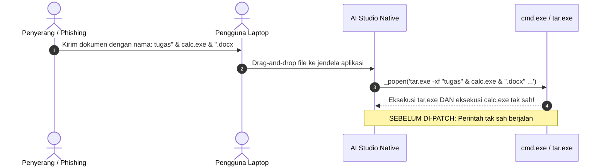

# ⚠️ Analisis Dampak Teknis & Skenario Ancaman (Threat Modeling)

## 🎯 Skenario Ancaman SEC-01 (Command Injection via File Name):

Dengan patch keamanan v2.8.0, aplikasi memvalidasi nama file pada langkah ke-2 dan langsung membatalkannya sebelum diteruskan ke sistem operasi.

Tautan Terkait:
- [[Audit_Celah_Keamanan_Total|Audit Keamanan Total]]
- [[00_DASHBOARD_OTAK_UTAMA|Kembali ke Dashboard Otak]]
